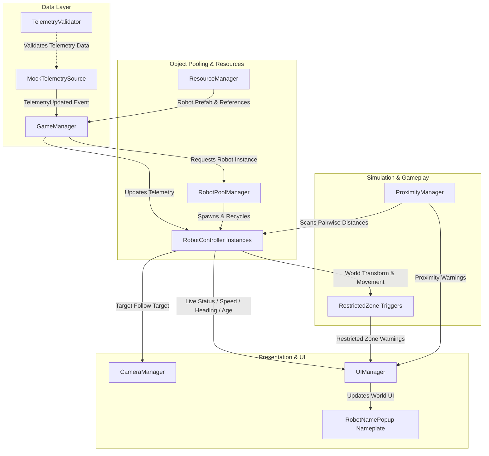

# Robot Monitoring System

A real-time 3D robot monitoring simulation built in **Unity 6 (6000.3.24f1)**. The system simulates autonomous robots receiving periodic telemetry data, smoothly interpolates their movement and rotation, provides an interactive UI dashboard for unit diagnostics, detects safety violations (proximity alerts and restricted zone breaches), and supports both free-flying and target-following camera systems.

---

## Table of Contents
1. [Setup Steps](#setup-steps)
2. [Controls & Keybindings](#controls--keybindings)
3. [Architecture Summary](#architecture-summary)
4. [Testing Suite](#testing-suite)
5. [Known Limitations](#known-limitations)
6. [Performance Considerations](#performance-considerations)

---

## Setup Steps

### Prerequisites
- **Unity Hub** installed.
- **Unity Editor Version**: `6000.3.24f1` (Unity 6) or compatible.
- **Platform**: Windows / macOS / Linux.

### Installation & Launching
1. **Clone or Download the Repository**:
   Clone the repository to your local machine:
   ```bash
   git clone <repository-url> "Robot Monitoring System"
   ```
2. **Open Project in Unity Hub**:
   - Open Unity Hub.
   - Click **Add** -> **Add project from disk**.
   - Select the root folder: `Robot Monitoring System`.
   - Ensure the editor version is set to `6000.3.24f1` (or allow Unity to upgrade/install the required editor version).
3. **Open the Simulation Scene**:
   - In the Unity Project window, navigate to:
     `Assets/Robot Monitoring Simulation/Scenes/Robot Management System Scene.unity`
   - Double-click to load the scene.
4. **Run the Simulation**:
   - Press the **Play** button in the Unity Editor toolbar.
   - Robots will automatically spawn via the object pool and start navigating the warehouse grid while emitting simulated telemetry packets.

---

## Controls & Keybindings

| Input | Mode / Context | Action |
| :--- | :--- | :--- |
| **Left Mouse Click** | Global View | **Select Robot**: Raycasts into the scene to select a robot unit. Displays live telemetry in the Robot Panel and highlights the overhead nameplate. |
| **W, A, S, D** / **Arrow Keys** | Free Camera Mode | **Move Camera**: Pan camera forward, backward, left, and right across the warehouse floor. |
| **Right Mouse Click (Hold & Drag)** | Free Camera Mode | **Look Around**: Rotate camera pitch (-10° to 80°) and yaw. |
| **F** | Global | **Toggle Camera Mode**: Switches between **Free Camera** and **Follow Camera** (smooth third-person chase camera locked on the selected robot). |

---

## Architecture Summary

The project is structured into modular layers adhering to separation of concerns across managers, simulation runtime, validation, and presentation.



### Core Components

1. **[`GameManager`](file:///Assets/Robot%20Monitoring%20Simulation/Scripts/Manager/GameManager.cs)**
   - Central coordinator and singleton entry point.
   - Subscribes to `MockTelemetrySource.TelemetryUpdated` and manages active robot instances in a fast lookup table (`Dictionary<string, RobotController>`).
   - Retrieves robot GameObject instances from `RobotPoolManager` upon receiving new robot IDs.

2. **[`MockTelemetrySource`](file:///Assets/Robot%20Monitoring%20Simulation/Scripts/Manager/MockTelemetrySource.cs)**
   - Emits simulated periodic telemetry frames (`robotId`, `position`, `speed`, `heading`, `isConnected`, `lastUpdateTime`).
   - Simulates realistic operational variables including bounded warehouse waypoints, obstacle-aware heading adjustments, probabilistic packet loss, and connection timeouts.

3. **[`TelemetryValidator`](file:///Assets/Robot%20Monitoring%20Simulation/Scripts/Gameplay/TelemetryValidator.cs)**
   - Pure, stateless data validation layer.
   - Verifies incoming packets for identifier validity, positive speeds, and finite coordinates (NaN/Infinity checks).

4. **[`RobotController`](file:///Assets/Robot%20Monitoring%20Simulation/Scripts/Gameplay/RobotController.cs)**
   - Handles localized representation of a robot in 3D space.
   - Interpolates between telemetry position packets using linear interpolation (`Vector3.Lerp`) and angular rotation smoothing (`Quaternion.RotateTowards`) to avoid jitter during discrete update intervals.

5. **[`RobotPoolManager`](file:///Assets/Robot%20Monitoring%20Simulation/Scripts/Manager/RobotPoolManager.cs)**
   - Pre-instantiates robot GameObjects based on configured fleet sizes to prevent runtime garbage collection (GC) allocations and instantiation hitches.
   - Dynamically expands the queue if telemetry spawns exceed initial fleet capacity.

6. **[`ProximityManager`](file:///Assets/Robot%20Monitoring%20Simulation/Scripts/Manager/ProximityManager.cs)**
   - Periodic background monitor (configured at 0.25s intervals) checking inter-robot distances.
   - Automatically raises and clears proximity warnings in the UI when two active robots breach safe operating margins.

7. **[`RestrictedZone`](file:///Assets/Robot%20Monitoring%20Simulation/Scripts/TriggerEvent/RestrictedZone_Trigg.cs)**
   - Trigger volume listener warning operators whenever a robot enters hazardous or off-limits warehouse boundaries.

8. **[`UIManager`](file:///Assets/Robot%20Monitoring%20Simulation/Scripts/Manager/UIManager.cs)**
   - Dashboard displaying active warnings (color-coded by priority/type), selected robot diagnostic data (ID, alphanumeric designation, speed, heading, position, data age, connection status), and current camera operational mode.

9. **[`CameraManager`](file:///Assets/Robot%20Monitoring%20Simulation/Scripts/Manager/CameraManager.cs)**
   - Handles multi-mode viewport controls: Free flight with WASD and right-click mouse-look, and smooth target-following view locked on the currently inspected robot.

---

## Testing Suite

The repository contains automated unit and integration tests located under:
`Assets/Robot Monitoring Simulation/Scripts/Gameplay/Testing/`

- **Editor Tests (`TelemetryValidatorTests.cs`)**:
  - Validates positive/finite numeric bounds.
  - Tests rejection of corrupted, NaN, and infinite position and heading values.
- **PlayMode Tests (`RobotPoolManagerTests.cs`)**:
  - Tests pre-allocation, dequeue/activation on `GetRobot()`, dynamic expansion under high load, and deactivation on `ReturnRobot()`.

To run tests:
- Open Unity Editor: **Window** -> **General** -> **Test Runner**.
- Run **PlayMode** and **EditMode** tests.

---

## Known Limitations

1. **Client-Side Simulation vs. Real Hardware Feed**:
   - The system currently uses `MockTelemetrySource` as an in-process mock data generator. Integrating physical robots requires implementing an external transport adapter (e.g., MQTT, WebSockets, or ROS2 bridge).
2. **Collision Avoidance Strategy**:
   - The collision avoidance logic in `MockTelemetrySource` uses discrete turn candidate checks. Under very high robot densities or tight bottleneck corridors, robots may hold position until paths clear.
3. **Pairwise Proximity Complexity**:
   - `ProximityManager` currently performs an $O(N^2)$ pairwise distance check. While suitable for typical warehouse fleet sizes (10–100 robots), larger fleets (500+ robots) require spatial partitioning.
4. **Warning Panel Display Capacity**:
   - The warning HUD prioritizes and displays the top 5 concurrent active warnings with an overflow cap.

---

## Performance Considerations

- **Object Pooling**:
  - Robot models and hierarchies are fully pooled via `RobotPoolManager`. Zero runtime instantiation or destruction occurs during continuous simulation, keeping garbage collection spikes minimal.
- **Throttled Proximity Updates**:
  - Rather than executing pairwise checks every frame (`Update`), `ProximityManager` runs on a timed interval (0.25s by default), minimizing CPU frame times.
- **Interpolation over Direct Transform Jumps**:
  - Telemetry updates arrive discretely (e.g., 0.5s intervals). Smooth interpolation in `RobotController.Update()` ensures steady 60+ FPS visuals without requiring high-frequency network packets.
- **Optimized UI Updates**:
  - Active warnings are managed via a dictionary and formatted on state change rather than string-allocated every frame.
- **Scalability Recommendations for Large Fleets (500+ Units)**:
  - Replace pairwise proximity checks with a spatial hash grid or Unity's Job System + Burst compiler (`IJobParallelFor`).
  - Batch UI nameplate billboarding or disable off-screen nameplate Canvas instances using `CullingGroup`.
  
### OPTIONAL BONUS WORK
### 1. Object Pooling
- Implemented `RobotPoolManager` to reuse robot GameObjects instead of repeatedly instantiating and destroying them.
- Pre-allocates robot instances to reduce runtime allocation overhead and minimize potential frame-time spikes.
- Returns inactive robots to the pool for reuse and supports dynamic pool expansion when the existing capacity is insufficient.
- Verified robot reuse through a PlayMode test that confirms a returned robot instance is reused when requested again.

### 2. Automated Testing
- Implemented automated EditMode tests for `TelemetryValidator` to verify valid telemetry and reject invalid identifiers, negative speed values, and non-finite position or heading values.
- Implemented PlayMode tests for `RobotPoolManager` to verify robot reuse and pooling behavior.
- Used Unity Test Framework to execute tests in the Unity Editor.
- Automated tests help identify regressions and improve confidence in telemetry validation and robot lifecycle management.

